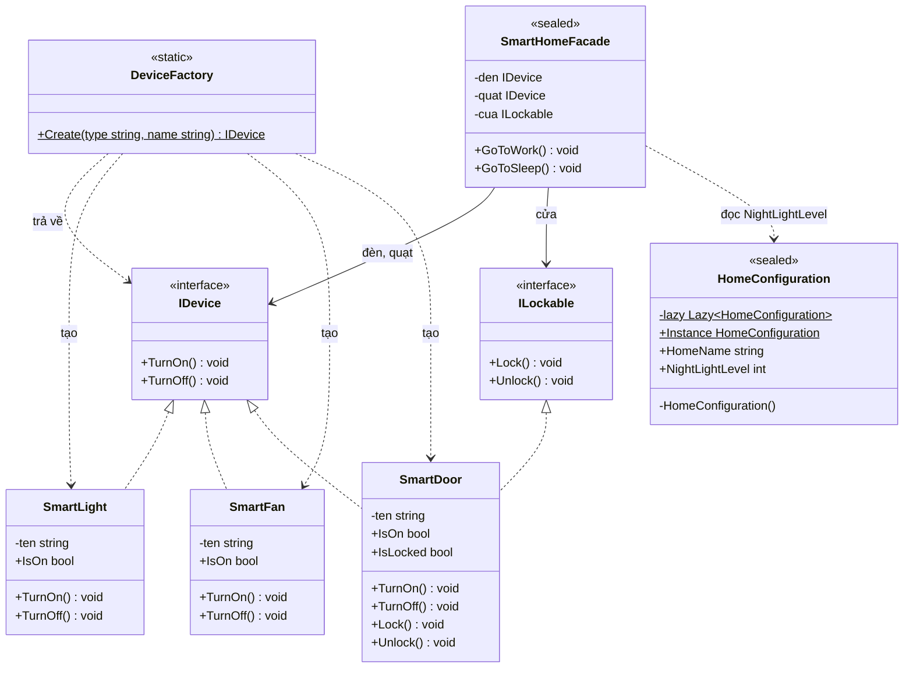

# Smart Home Mini

Ứng dụng điều khiển nhà thông minh gồm đèn, quạt, cửa. Dùng 3 pattern: Factory, Singleton, Facade.

## Phần A: Phân tích thiết kế

| Nội dung | Thành phần |
|---|---|
| Abstraction chung của thiết bị | `IDevice` (`TurnOn`, `TurnOff`) |
| Hành vi riêng của cửa | `ILockable` (`Lock`, `Unlock`). Tách riêng vì đèn và quạt không có khả năng khóa. `SmartDoor` cài cả `IDevice` và `ILockable` |
| Thành phần tạo thiết bị | `DeviceFactory` |
| Dữ liệu thuộc cấu hình chung | `HomeName`, `NightLightLevel` (dùng chung cho cả ngôi nhà). Trạng thái từng thiết bị (`IsOn`, `IsLocked`) và tên thiết bị thì không thuộc cấu hình chung |
| Phụ thuộc facade cần giữ | `IDevice` (đèn), `IDevice` (quạt), `ILockable` (cửa) và `HomeConfiguration.Instance` (đọc mức sáng ban đêm) |
| Cách client gọi chế độ | Tạo `SmartHomeFacade` một lần, sau đó chỉ gọi `GoToWork()` hoặc `GoToSleep()`, không cần biết chi tiết từng thiết bị |

## Sơ đồ lớp UML

## Vị trí dùng từng pattern và lợi ích

| Pattern | Vị trí | Lợi ích |
|---|---|---|
| Factory | `DeviceFactory.Create(...)` | Client không gọi `new` từng loại thiết bị, chỉ làm việc qua `IDevice`. Thêm loại mới chỉ sửa ở Factory |
| Singleton | `HomeConfiguration.Instance` | Cả ứng dụng dùng chung một cấu hình, đổi ở một nơi thì nơi khác thấy ngay. `Lazy<T>` an toàn khi chạy nhiều luồng |
| Facade | `SmartHomeFacade` | Client kích hoạt chế độ Đi làm, Đi ngủ chỉ bằng một lệnh. Client vẫn điều khiển riêng từng thiết bị được |

## Một hạn chế của thiết kế

`SmartHomeFacade.GoToSleep()` gọi thẳng `HomeConfiguration.Instance`, nên facade phụ thuộc ngầm vào một đối tượng toàn cục. Khi unit test, mức sáng đặt ở test này có thể ảnh hưởng test khác, và không thay được cấu hình giả vào facade.

## Kiểm thử

| Mã | Tình huống | Kết quả mong đợi |
|---|---|---|
| T1 | Tạo light, fan, door bằng Factory (cả chuỗi `"  LiGhT "`) | Trả đúng `SmartLight`, `SmartFan`, `SmartDoor` |
| T2 | Tạo loại `camera` | Ném `ArgumentException` |
| T3 | Lấy `HomeConfiguration.Instance` hai lần | Cùng một đối tượng, đổi `HomeName` qua biến này thì biến kia cũng đổi |
| T4 | Gọi `GoToWork()` | Đèn tắt, quạt tắt, cửa khóa |
| T5 | Gọi `GoToSleep()` | Quạt tắt, cửa khóa, đèn bật, hiện `Night light level: 40%` |
| T6 | Tắt riêng đèn, không qua facade | Đèn tắt |

## Trả lời câu hỏi

### Phần C: Factory

1. **Factory che giấu điều gì đối với client?** Che quyết định chọn lớp cụ thể nào và cách khởi tạo nó. Client chỉ đưa chuỗi loại thiết bị và nhận về `IDevice`.
2. **Khi thêm `SmartCamera`, cần sửa gì?** Viết thêm lớp `SmartCamera : IDevice` và thêm một dòng vào `switch` trong `DeviceFactory`. Client không phải sửa.

### Phần D: Singleton

1. **Constructor có mức truy cập nào?** `private`, để bên ngoài không dùng được `new` và tạo thêm đối tượng.
2. **Vì sao lớp là `sealed`?** Để không ai kế thừa rồi tạo thêm thể hiện thứ hai, phá vỡ đảm bảo "chỉ có một".
3. **Singleton gây khó khăn gì cho unit test?** Nó là trạng thái toàn cục nên giá trị đặt ở test này còn dính sang test khác. Các lớp dùng nó có phụ thuộc ngầm, khó thay bằng đối tượng giả.
4. **Dùng DI với `AddSingleton` thì có cần tự cài Singleton không?** Không nhất thiết. `AddSingleton` đã quản lý vòng đời để chỉ có một thể hiện. Constructor có thể để `public` và dễ thay bằng đối tượng giả khi test.

### Phần G

1. **Factory đang che giấu quyết định thiết kế nào?** Quyết định dùng lớp cụ thể nào cho từng loại thiết bị và cách tạo nó.
2. **Singleton bảo đảm điều gì, tạo ra rủi ro nào?** Bảo đảm chỉ có một thể hiện duy nhất. Rủi ro là phụ thuộc ẩn và trạng thái toàn cục, gây khó unit test.
3. **Facade khác Factory ở mục đích chính như thế nào?** Factory dùng để **tạo** đối tượng. Facade dùng để **đơn giản hóa cách dùng** nhiều đối tượng có sẵn qua một giao diện.
4. **Nếu bỏ `SmartHomeFacade`, client phải biết thêm gì?** Phải biết có những thiết bị nào, thứ tự thao tác của từng chế độ, thao tác nào dành riêng cho cửa (`Lock`), và phải tự đọc `NightLightLevel` từ `HomeConfiguration`.
